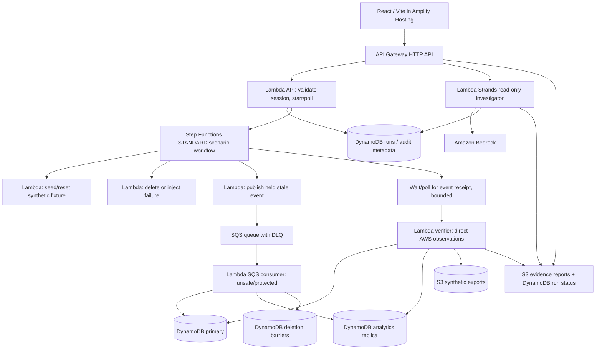

# AWS-first architecture — authoritative target design

**Status:** proposed, not deployed or tested against AWS. **AWS region:** choose one region with verified Bedrock model access; do not assume model availability. **Data:** synthetic-only. **Category:** Frankenstein (proposed); demonstrate distinct cross-technology roles, not service count.

This is the authoritative *target* design and supersedes the original local SQLite deployment plan. `apps/api` (Fastify) is a LOCAL development shell only. The production target has no persistent VM or local databases. The existing contracts/engine remain framework-independent. Keep the local in-memory adapter for unit tests, but P0 evidence must come from real AWS test-store queries.

## AWS product responsibilities

- **Amplify Hosting**: host React SPA with HTTPS/preview deploys; use custom API base URL. Do not add Amplify Gen 2 backend automatically when AWS CDK owns the backend.
- **API Gateway HTTP API + Lambda**: POST `/api/runs` -> validate and start async Step Functions execution; `GET /api/runs/{id}` -> status; `GET /api/runs/{id}/evidence` -> server-mediated evidence view; POST `/api/runs/{id}/explain` -> optional Bedrock agent analysis. No arbitrary AWS commands, credentials, customer data or raw SQL accepted.
- **Step Functions STANDARD**: auditable scenario execution, limited retries, explicit timeouts, and evidence of which AWS calls happened. Choose Standard over Express for execution history and a clearer demonstration. Handle downstream retry/idempotency in code; Standard does not magically make external side effects exactly once.
- **DynamoDB**: independent primary and analytics test tables; separate run metadata and deletion-barrier tables. Keys include `runId`, `subjectId`, `generation`. Prefer strongly consistent reads of base tables when verifying. TTL only for *eventual cleanup*, never immediate deletion proof.
- **SQS**: actual asynchronous message transport, Lambda consumer, DLQ. P0 scenario creates a stale event from an earlier snapshot then **publishes it after deletion** to deterministically reproduce delayed delivery. This is an explicit injected delay, not a claim that SQS always reorders messages. Delivery can be duplicated; worker must be idempotent.
- **S3**: independent export objects and downloadable evidence. For P0, synthetic export store need not enable versioning. Versioned-object deletion should be a separate P1 scenario which uses `ListObjectVersions` and discusses delete markers.
- **Strands + Bedrock**: a *read-only* investigator on a separate Lambda invocation after a run finishes. Bedrock explanations do not determine PASS/FAIL/UNKNOWN. Optional AgentCore Runtime migration is P2 only, if the demo is stable and measurable need exists.
- **AWS CDK (TypeScript)**: a single deployable infra stack; explicit IAM per Lambda role, cost controls, encryption, access logging and retention. NO broad wildcard permissions and NO auto-deploy from a pull request.
- **CloudWatch / Powertools**: structured synthetic-only logs, trace correlation IDs, alarms for failures and budgeted invocations.

## Workflow semantics

1. Authorize a judge/demo session, cap concurrent active runs, assign opaque run ID.
2. Seed a bounded synthetic fixture in primary, analytics, export and a *held-event record* in run metadata. Persist a fixture hash and scenario version.
3. Delete subject from the configured stores; record deletion barrier. For partial-delete scenario, deliberately fail analytics deletion using a scoped test-only fault flag.
4. Publish the pre-created stale upsert event to SQS after deletion (fault injection). The SQS consumer is deployed in either explicitly **unsafe** or **protected** mode per run; unsafe only touches sandbox run partitions. The protected worker uses `TransactWriteItems` to atomically `ConditionCheck` the barrier and write the replica (plus an idempotency record as needed), or an equivalent schema-safe conditional strategy.
5. Wait for a bounded consumer acknowledgment/status; never verify until the worker result is observed or the timeout is reached. If the outcome is unavailable, verdict is UNKNOWN.
6. Independent verifier reads *actual* DynamoDB stores and S3 object state, creates provenance/evidence, and derives verdict via pure, tested reducer.
7. Persist a report to S3 and status metadata to DynamoDB, available over authenticated API. Bedrock investigator may generate an optional narrative grounded in stored evidence only.

## API behavior and security

- API starts runs asynchronously: HTTP `202 Accepted` with run ID and status URL, no long-running API request.
- Every request and resource scoped by a non-guessable session + run ID; enforce ownership server-side. Never trust a run ID alone as authorization.
- Demo judge account in Cognito or restricted demo session; no default unrestricted public action endpoints. API Gateway route throttling is a backstop, not a cost ceiling.
- Separate dev and public demo environments, restricted concurrency and per-session quotas, bounded fixture sizes and event counts, short-lived data retention, DLQs, alarms, budget alerts and documented cleanup.
- Agent inputs must come from allowlisted, sanitized evidence; no filesystem, shell, AWS-control-plane or write tools.
- No inference of global erasure. `UNKNOWN` when a required store cannot be verified.

## Explicitly deferred

- Live production connections, unrestricted user-defined AWS resource names/ARNs, S3 buckets with arbitrary keys, cross-region/global tables, streaming agent conversations, Bedrock AgentCore Runtime, user PII, user-supplied system prompts, automatic production remediation, and full legal compliance determinations.

## AWS sources

- Strands SDK: https://strandsagents.com/docs/
- Strands Lambda deployment: https://strandsagents.com/docs/user-guide/sdk/deploy/deploy_to_aws_lambda/
- Step Functions workflow types: https://docs.aws.amazon.com/step-functions/latest/dg/choosing-workflow-type.html
- DynamoDB transactions: https://docs.aws.amazon.com/amazondynamodb/latest/developerguide/transactions.html
- DynamoDB TTL: https://docs.aws.amazon.com/amazondynamodb/latest/developerguide/TTL.html
- S3 object versions: https://docs.aws.amazon.com/AmazonS3/latest/userguide/DeletingObjectVersions.html
- SQS delay limitation: https://docs.aws.amazon.com/AWSSimpleQueueService/latest/SQSDeveloperGuide/sqs-delay-queues.html

## Frankenstein integration contract

1. **Fact generation:** Step Functions / SQS / Lambda produce persisted synthetic events and AWS storage state. Store run IDs, sequence numbers, trace IDs, and immutable evidence references.
2. **Authoritative verification:** A read-only verifier queries actual configured DynamoDB/S3 stores, derives PASS/FAIL/UNKNOWN, and stores evidence and scope. No Bedrock/Strands invocation on the authoritative verdict path.
3. **Advisory reasoning:** A separate least-privilege Strands Lambda uses only four allowlisted read tools to analyze persisted, sanitized evidence after a completed run. The server injects (never accepts from AI) `verdictFromVerifier`. Return `UNAVAILABLE` on model failure.
4. **Evidence UI:** React Ghost Graph and Séance Timeline render observed events and agent suggestions **with evidence IDs**, separating observations from hypotheses. The same root-cause finding should be traceable from AWS event to assertion, agent explanation, and visual highlight.

**Demo quality bar:** at least one observable unsafe failure, a protected replay with verified PASS, a successful on-demand Strands explanation citing real evidence IDs, and a Bedrock-disabled fallback. Do not auto-run costly agent calls for every visitor. Record exact AWS resources, traces, model/region used, and one measured run in `docs/BUILD_LOG.md`. See `docs/FRANKENSTEIN-EVIDENCE-MATRIX.md`.

## v4 optional agent-safety evidence flow (no additional AWS services)

P1 reuses existing orchestration and test-store adapters: Step Functions/Lambda scenario operation emits a server-created `ActionIntent` and `PolicyDecision`, a bounded `ExecutionReceipt`, and a **separate** direct DynamoDB/S3 verifier observation. Correlate with existing `runId`, logical event order, and evidence IDs. IAM restricts writes to synthetic test resources; public clients never pass AWS ARNs or credentials. Strands sees only sanitized evidence through read-only tools.

P2, if explicitly prioritized and approved, provides a **non-executable** destructive proposal type denied by a server-owned synthetic gateway; it does not add AWS admin actions, arbitrary tools or external agent integrations. An inaccessible test resource yields `UNKNOWN`, not proof of prevention. No new AWS product or permission is justified solely by the article.
